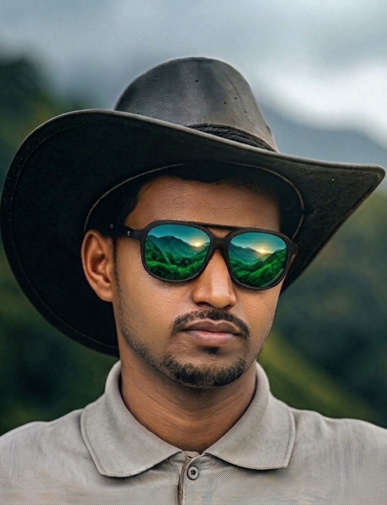

<!-- =========================================================
     SONAI DAS | PREMIUM GITHUB PROFILE
     Theme: Midnight Navy · Sky Blue · Ice Blue
            Platinum Silver · Champagne Gold
     Files in repository root:
       README.md
       profile-photo.jpg
========================================================== -->

<!-- ===================== HERO ===================== -->

<table>
<tr>
<td align="center" valign="middle" width="38%">

</td>

<td align="left" valign="middle" width="62%">

<h3>HELLO, I'M SONAI 👋</h3>

<h1>Web Designer Developer & Data Analyst</h1>

I craft clean digital experiences, build interactive web interfaces,
and transform data into meaningful insights.

</td>
</tr>
</table>

---

<!-- ===================== PROFILE ===================== -->

<h2>01 / PROFILE</h2>

I'm a multidisciplinary <strong>Web Designer, Developer, and Data Analyst</strong>
based in West Bengal, India. I work at the intersection of visual design,
frontend engineering, interactive experiences, and analytical thinking.

My focus is to create digital experiences that are not only visually refined,
but also functional, responsive, accessible, and purposeful.

<blockquote>
<strong>DESIGN PHILOSOPHY</strong> 
Minimalism backed by data. Aesthetics engineered for performance.
</blockquote>

<table>
<tr>
<td width="50%">

<strong>LOCATION</strong> 
West Bengal, India

</td>
<td width="50%">

<strong>FOCUS</strong> 
Design · Development · Analytics

</td>
</tr>
<tr>
<td width="50%">

<strong>APPROACH</strong> 
Clarity · Precision · Innovation

</td>
<td width="50%">

<strong>PORTFOLIO</strong> 
<a href="https://dassonai.netlify.app/">Visit Website ↗</a>

</td>
</tr>
</table>

---

<!-- ===================== CAPABILITIES ===================== -->

<h2>02 / CAPABILITIES</h2>

<table>
<tr>
<td width="33%" valign="top">

<h3>◈ Web Design</h3>

Creating modern, elegant, and brand-focused interfaces with thoughtful
typography, spacing, composition, and visual hierarchy.

</td>

<td width="33%" valign="top">

<h3>⌘ Frontend Development</h3>

Building interactive, responsive, and maintainable web experiences
with modern frontend technologies.

</td>

<td width="33%" valign="top">

<h3>▤ Data Analytics</h3>

Exploring structured data, discovering trends, and transforming
information into meaningful insights.

</td>
</tr>

<tr>
<td width="33%" valign="top">

<h3>✳ UI / UX</h3>

Designing intuitive user journeys, clear interactions,
and friction-free digital experiences.

</td>

<td width="33%" valign="top">

<h3>▣ Responsive Design</h3>

Creating fluid layouts and consistent experiences
across desktop, tablet, and mobile.

</td>

<td width="33%" valign="top">

<h3>↗ Digital Solutions</h3>

Developing thoughtful digital solutions for creators,
individuals, and businesses.

</td>
</tr>
</table>

---

<!-- ===================== TECH STACK ===================== -->

<h2>03 / TECHNOLOGY</h2>

<h3>Frontend Development</h3>

<h3>Animation & Visuals</h3>

<h3>Tools & Workflow</h3>

---

<!-- ===================== PROJECTS ===================== -->

<h2>04 / SELECTED PROJECTS</h2>

<table>
<tr>
<td width="50%" valign="top">

<h3>01 — Personal Portfolio</h3>

My personal portfolio showcasing web design, development,
animations, responsive layouts, and digital services.

</td>

<td width="50%" valign="top">

<h3>02 — Interactive Experiences</h3>

Frontend experiments exploring animation, interaction,
creative development, and immersive visual experiences.

</td>
</tr>

<tr>
<td width="50%" valign="top">

<h3>03 — Data & Dashboards</h3>

Analytical projects and dashboard concepts designed to
present information clearly and support data-driven decisions.

</td>

<td width="50%" valign="top">

<h3>04 — UI / UX Concepts</h3>

Interface concepts and redesigns focused on usability,
modern aesthetics, responsive layouts, and visual clarity.

</td>
</tr>
</table>

<em>More projects and case studies coming soon.</em>

---

<!-- ===================== GITHUB STATS ===================== -->

<h2>05 / GITHUB STATISTICS</h2>

  

  

---

<!-- ===================== CONNECT ===================== -->

<h2>06 / LET'S CONNECT</h2>

Open to collaborations, freelance web design & development projects,
and data analytics opportunities.

---

<!-- ===================== FOOTER ===================== -->

<h3>DESIGN WITH INTENT. BUILD WITH PRECISION.</h3>

<em>"Design is not just what it looks like and feels like.
Design is how it works."</em>

<strong>Designed & Built by Sonai Das</strong>

  

